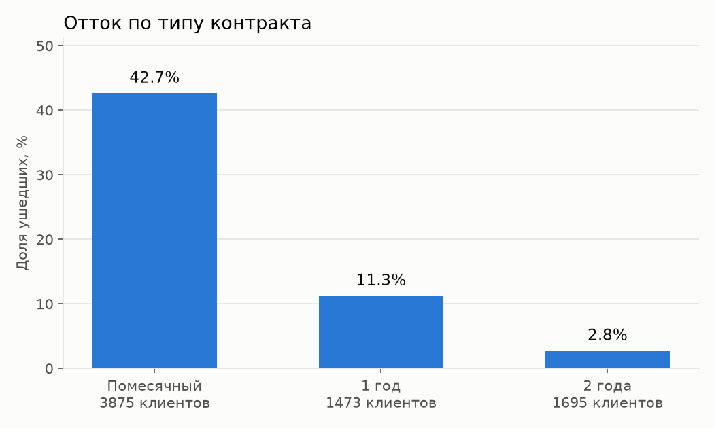
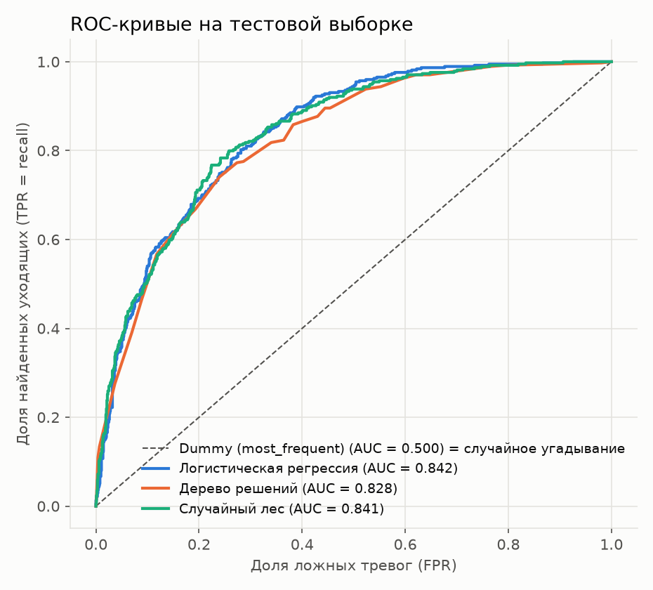
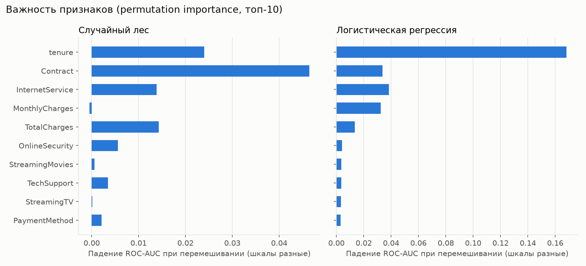

# Предсказание оттока клиентов телеком-компании

Учебный проект по продуктовой аналитике: SQL-анализ, простые модели машинного обучения
и выводы для бизнеса на данных о клиентах телеком-оператора.

## Цель

1. Понять, какие клиенты уходят чаще (SQL + описательная статистика).
2. Построить простые модели, которые по данным клиента оценивают вероятность его ухода,
   и честно сравнить их с базовым ориентиром.
3. Найти факторы, связанные с оттоком, и сформулировать выводы для бизнеса.

## Данные

[Telco Customer Churn (Kaggle)](https://www.kaggle.com/datasets/blastchar/telco-customer-churn) —
файл `data/WA_Fn-UseC_-Telco-Customer-Churn.csv`.

- **7043 клиента, 21 столбец**: пол, возраст (SeniorCitizen), семья (Partner, Dependents),
  срок обслуживания в месяцах (`tenure`), подключённые услуги (телефон, интернет,
  онлайн-защита, техподдержка, ТВ и т.д.), тип контракта, способ оплаты, платежи
  (`MonthlyCharges`, `TotalCharges`) и целевая переменная `Churn` (ушёл ли клиент).
- Явных пропусков нет, но `TotalCharges` хранится как текст, и в **11 строках** там пробел.
  У всех этих клиентов `tenure = 0`: они только подключились и ещё ничего не заплатили,
  поэтому пустое значение заменено на 0.
- **Ушли 1869 клиентов — 26.5%.** Классы несбалансированы: оставшихся почти в 3 раза больше.

## Структура проекта

```
data/        исходный CSV
sql/         SQL-запросы (выполняются в SQLite из analysis.py)
analysis.py  весь анализ: EDA → SQL → подготовка → модели → метрики → интерпретация → графики → самопроверка
images/      графики
results/     таблицы с результатами (метрики, SQL-выборки, коэффициенты, важность признаков)
```

## Как запустить

Проверено на Python 3.15.2 с версиями библиотек из `requirements.txt`.

```bash
python -m venv .venv
.venv\Scripts\activate          # Windows; на macOS/Linux: source .venv/bin/activate
pip install -r requirements.txt
python analysis.py
```

Скрипт печатает все результаты в консоль, сохраняет графики в `images/`, таблицы в `results/`
и в конце запускает самопроверку (сверяет SQL с pandas, пересчитывает метрики из матрицы ошибок,
проверяет, что train и test не пересекаются). Случайность зафиксирована (`random_state=42`),
поэтому числа при повторном запуске совпадают.

## 1. Что показал SQL

**Отток по типу контракта** (`sql/01_churn_by_contract.sql`)

| Контракт | Клиентов | Ушли | Отток |
|---|---:|---:|---:|
| Помесячный (Month-to-month) | 3875 | 1655 | **42.7%** |
| 1 год | 1473 | 166 | 11.3% |
| 2 года | 1695 | 48 | 2.8% |



**Отток по сроку обслуживания** (`sql/02_churn_by_tenure.sql`)

| Срок | Клиентов | Ушли | Отток | Средний платёж в месяц |
|---|---:|---:|---:|---:|
| 0–12 мес | 2186 | 1037 | **47.4%** | 56.10 |
| 13–24 мес | 1024 | 294 | 28.7% | 61.36 |
| 25–48 мес | 1594 | 325 | 20.4% | 65.93 |
| 49–72 мес | 2239 | 213 | 9.5% | 73.95 |

**Отток по способу оплаты** (`sql/03_churn_by_payment.sql`)

| Способ оплаты | Клиентов | Отток | Доля помесячных контрактов |
|---|---:|---:|---:|
| Electronic check | 2365 | **45.3%** | 78.2% |
| Mailed check | 1612 | 19.1% | 55.4% |
| Bank transfer (automatic) | 1544 | 16.7% | 38.1% |
| Credit card (automatic) | 1522 | 15.2% | 35.7% |

Важно: среди тех, кто платит электронным чеком, 78% сидят на помесячном контракте.
Значит, высокий отток в этой группе во многом объясняется типом контракта, а не только способом оплаты.

**Дополнительно:** по типу интернета (`sql/04_churn_by_internet_service.sql`) у оптоволокна
отток 41.9% при среднем платеже 91.50, у DSL 19.0% при 58.10, без интернета 7.4%.
Без техподдержки (`sql/05_churn_by_tech_support.sql`) уходит 41.6% клиентов, с ней 15.2%.

## 2. Подготовка данных

- `TotalCharges` → число, 11 пустых значений → 0 (это клиенты с `tenure = 0`).
- `SeniorCitizen` 0/1 → No/Yes, чтобы все бинарные признаки кодировались одинаково.
- `customerID` удалён: это просто номер, он не говорит ничего о поведении клиента.
- Разделение **80/20 со `stratify`**: train 5634 клиента, test 1409; доля ушедших в обеих частях 26.5%.
- **Без утечки данных:** масштабирование чисел (`StandardScaler`) и кодирование категорий
  (`OneHotEncoder`) собраны в `Pipeline` вместе с моделью. Они «учатся» (запоминают средние,
  списки категорий) только на train, а к test только применяются. Тестовая выборка не участвует
  ни в подготовке, ни в настройке моделей: для оценки стабильности использована
  5-кратная кросс-валидация на train.

## 3. Модели и как они работают

**Пример клиента для объяснений** (вымышленный, его оценивает `analysis.py`): Анна, помесячный
контракт, 3 месяца с компанией, оптоволокно за 75 в месяц, без доп. услуг, платит электронным чеком.

**Dummy (базовый ориентир).** Всегда отвечает самым частым классом: «клиент останется».
Про Анну скажет «останется» (вероятность ухода 0.00), про всех остальных тоже. Он ничего не знает
о клиентах, и это нижняя планка: если модель не лучше Dummy, она бесполезна.

**Логистическая регрессия.** Каждому признаку назначается вес. Для Анны модель складывает:
«помесячный контракт» (+), «мало месяцев с компанией» (+), «оптоволокно» (+),
«нет техподдержки» (+), «электронный чек» (+). Сумма через S-образную функцию (сигмоиду)
превращается в вероятность от 0 до 1. **Для Анны получилось 0.67**, то есть «67% шанс ухода».
Плюсы: быстро, понятно, видно направление влияния каждого признака. Минус: умеет только
«складывать» эффекты и плохо ловит сложные сочетания вида «X опасен, только если одновременно Y».

**Дерево решений.** Цепочка вопросов «да/нет», которую модель сама подобрала по данным.
Реальный путь Анны по дереву из проекта: «контракт помесячный?» — да → «оптоволокно?» — да →
«мало месяцев с компанией?» — да → «суммарно заплатила совсем мало?» — нет →
«ежемесячный платёж ниже порога?» — да → лист, куда попали 167 клиентов из train, из них ушли 51.5%.
**Это и есть оценка для Анны: 0.51.** Плюсы: легко нарисовать и объяснить, само находит сочетания
признаков. Минусы: нестабильно (немного другие данные дают другое дерево) и легко «зазубривает»
train, поэтому глубина ограничена 5 уровнями.

**Случайный лес.** 300 деревьев, каждое обучено на случайной подвыборке клиентов
и признаков. Про Анну каждое дерево даёт свою оценку, а лес их усредняет:
**получилось 0.64.** Усреднение убирает нестабильность одного дерева. Плюсы: обычно точнее одного
дерева, ловит сложные зависимости. Минусы: «чёрный ящик», объяснять сложнее.

**Когда что лучше:** логистическая регрессия хороша, когда зависимости простые и нужна
объяснимость (как в этой задаче). Дерево — когда нужно объяснить правила людям
без технического бэкграунда. Лес — когда важнее качество и есть сложные взаимодействия признаков.

## 4. Метрики

Матрица ошибок делит клиентов из test на 4 группы: TP — ушёл, и модель это предсказала;
FN — ушёл, а модель пропустила; FP — остался, а модель подняла ложную тревогу; TN — остался, и модель
это предсказала.

- **Accuracy** — доля верных ответов вообще.
- **Precision** — из тех, кого модель назвала «уйдёт», сколько реально ушли (точность тревог).
- **Recall** — из тех, кто реально ушёл, скольких модель нашла (полнота).
- **F1** — среднее гармоническое precision и recall: высокое, только если оба высокие.
- **ROC-AUC** — насколько хорошо модель ранжирует клиентов: вероятность, что случайный ушедший
  получит более высокую оценку риска, чем случайный оставшийся. 0.5 — случайное угадывание, 1.0 — идеал.
  Не зависит от выбора порога.

**Почему accuracy здесь обманчива.** Dummy, который всем говорит «останется», получает
accuracy **73.5%** и при этом не находит **ни одного** уходящего клиента (recall = 0).
При дисбалансе классов высокая accuracy достигается просто угадыванием большинства.
Поэтому смотрим на recall, precision, F1 и ROC-AUC.

## 5. Результаты (тестовая выборка, 1409 клиентов, порог 0.5)

| Модель | Accuracy | Precision | Recall | F1 | ROC-AUC | ROC-AUC, CV на train (среднее ± ст. откл.) |
|---|---:|---:|---:|---:|---:|---:|
| Dummy (most_frequent) | 0.735 | 0.000 | 0.000 | 0.000 | 0.500 | 0.500 ± 0.000 |
| **Логистическая регрессия** | **0.806** | **0.657** | 0.559 | **0.604** | **0.842** | 0.846 ± 0.013 |
| Дерево решений (глубина 5) | 0.798 | 0.635 | **0.567** | 0.599 | 0.828 | 0.827 ± 0.012 |
| Случайный лес (300 деревьев) | 0.796 | 0.644 | 0.513 | 0.571 | 0.841 | 0.845 ± 0.010 |



**Матрица ошибок логистической регрессии:**

| | Прогноз: остался | Прогноз: ушёл |
|---|---:|---:|
| **Факт: остался** (1035) | 926 (TN) | 109 (FP) |
| **Факт: ушёл** (374) | 165 (FN) | 209 (TP) |

**Как читать результаты честно:**
- По **accuracy** модели лучше ориентира всего на 6–7 п.п. (80.6% против 73.5%).
  Это выглядит скромно, но и не является главным: Dummy не находит ни одного уходящего клиента.
- По **ROC-AUC** разница существенная: 0.84 против 0.50. Модели действительно умеют
  отличать рискованных клиентов от надёжных.
- Даже лучшая модель при пороге 0.5 находит только **56% уходящих** (209 из 374).
- **Случайный лес не лучше логистической регрессии** (0.841 против 0.842 на test,
  0.845 против 0.846 на кросс-валидации; разница меньше разброса между фолдами ±0.01).
  Значит, сложная модель здесь не даёт выигрыша, и разумно выбрать более простую и объяснимую
  логистическую регрессию. Дерево немного хуже по ROC-AUC (0.828).

**Порог можно сдвигать.** Модель выдаёт вероятность, а порог 0.5 выбран по умолчанию.
Если удержание дешёвое (письмо, скидка), выгоднее ловить больше уходящих ценой ложных тревог.
Иллюстрация для логистической регрессии на test:

| Порог | Отмечено «уйдёт» | Найдено уходящих (TP) | Recall | Precision |
|---:|---:|---:|---:|---:|
| 0.5 | 318 | 209 из 374 | 55.9% | 65.7% |
| 0.3 | 543 | 282 из 374 | 75.4% | 51.9% |

Это только иллюстрация компромисса. Рабочий порог нужно выбирать на отдельной валидационной
выборке и с учётом стоимости удержания и ценности клиента.

## 6. Какие факторы связаны с оттоком

**Важность признаков (permutation importance):** перемешиваем один столбец на test и смотрим,
насколько падает ROC-AUC. Чем сильнее падение, тем больше модель опирается на признак.



У обеих моделей в топе одни и те же группы признаков: **срок обслуживания (`tenure`), тип контракта,
тип интернета и платежи** (лес опирается на `TotalCharges`, регрессия на `MonthlyCharges`
и `TotalCharges`). Пол, наличие партнёра и телефонная связь почти ни на что не влияют
(важность около нуля). Шкалы на двух панелях разные: у регрессии большая важность `tenure`
отчасти объясняется тем, что она уравновешивает `tenure` и `TotalCharges` между собой (см. ниже).

**Отношения шансов из логистической регрессии** (при прочих равных признаках клиента,
`results/logreg_pairwise_odds_ratios.csv`):

| Сравнение | Шансы ухода выше в |
|---|---:|
| Помесячный контракт vs 2 года | 3.84 раза |
| Помесячный контракт vs 1 год | 2.01 раза |
| Оптоволокно vs DSL | 3.65 раза |
| Электронный чек vs автоплатёж картой | 1.51 раза |
| Электронный чек vs автоплатёж с банковского счёта | 1.47 раза |
| Без онлайн-защиты vs с ней | 1.39 раза |
| Без техподдержки vs с ней | 1.32 раза |

Обратите внимание: в «сырой» статистике электронный чек выглядит очень опасным (45.3% оттока против 15.2%),
а при учёте контракта и других признаков эффект намного скромнее (×1.5). Это хороший пример того,
почему одна группировка может вводить в заблуждение.

Коэффициенты числовых признаков по отдельности лучше не трактовать: `TotalCharges` почти равен
`tenure × MonthlyCharges`, эти три признака сильно связаны, и модель «делит» эффект между ними
(например, у `MonthlyCharges` коэффициент отрицательный, хотя в SQL дорогие тарифы уходят чаще).
Надёжный вывод здесь только общий: **чем дольше клиент с компанией, тем ниже риск ухода.**

## 7. Выводы для бизнеса

1. **Главный фактор — тип контракта.** На помесячном контракте уходит 42.7% клиентов,
   на двухлетнем 2.8%. Даже при прочих равных шансы ухода у помесячных в 3.8 раза выше.
   *Идея:* предлагать переход на годовой контракт (скидка, бонус) и проверить эффект A/B-тестом.
2. **Первый год — самый рискованный.** В первые 12 месяцев уходит 47.4% клиентов,
   после 4 лет только 9.5%. *Идея:* программа онбординга и проактивные контакты в первые месяцы.
3. **Оптоволокно — проблемная зона.** Отток 41.9% против 19.0% у DSL, и шансы ухода выше
   в 3.65 раза даже при учёте остальных признаков. Это самый дорогой тариф (91.50 в среднем).
   *Идея:* разобраться, в чём дело: в цене, качестве связи или конкурентах (опросы, данные об обращениях).
4. **Сервисные услуги и автоплатёж связаны с удержанием.** Без техподдержки уходит 41.6%, с ней 15.2%;
   электронный чек связан с более высоким риском, чем автоплатёж. *Идея:* предлагать техподдержку,
   онлайн-защиту и автоплатёж, особенно новым клиентам на помесячном контракте.
5. **Модель можно использовать для приоритизации удержания:** при пороге 0.3 логистическая регрессия
   находит 75% уходящих клиентов, причём примерно каждый второй отмеченный (51.9%) действительно уходит.

## Ограничения

- **Связь ≠ причинность.** Модель показывает, какие признаки *сопутствуют* оттоку, но не доказывает,
  что перевод клиента на годовой контракт *заставит* его остаться: на длинный контракт могут
  соглашаться изначально более лояльные клиенты. Проверять гипотезы нужно экспериментами (A/B-тестами).
- **Данные одного периода.** Это один «снимок» базы клиентов без дат: нельзя проверить, как модель
  работает на будущих месяцах, и учесть сезонность или изменения цен.
- **Нет поведенческих данных:** обращений в поддержку, качества связи, предложений конкурентов,
  а именно они часто объясняют уход лучше всего.
- **Учебный датасет** (пример от IBM), около 7 тысяч клиентов; на реальных данных результаты могут отличаться.
- Гиперпараметры моделей выбраны разумными значениями по умолчанию, без перебора. Порог 0.3 показан
  на test как иллюстрация, а не как подобранный.
